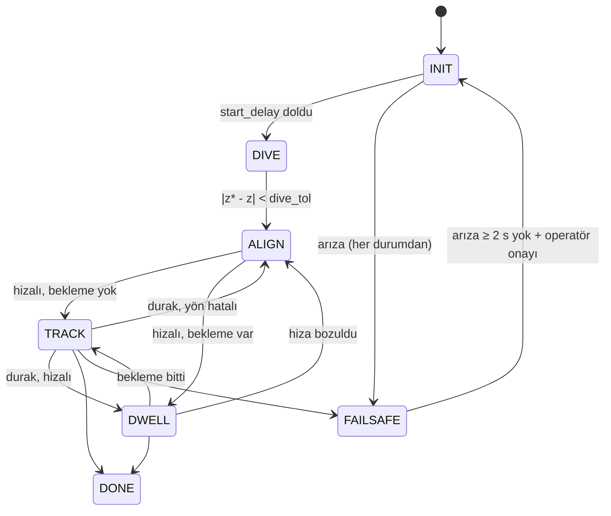

<!-- =============================================================================
     DOSYA : README.md
     AMAÇ  : Paketin ne yaptığı, Ödev 2 (State Machine + FAILSAFE) ile neyin değiştiği, nasıl kurulup
             çalıştırıldığı ve test sonuçları. (Matematik: ilgili .py dosyalarının yorumlarında.)
     ============================================================================= -->
# sualti_sim_son — State Machine + FAILSAFE

Gazebo'da fizikle yüzen takım aracı (55 x 48 x 20,5 cm): nötr yüzdürme, hidrodinamik sürtünme, 4 yatay itici (X dizilimi) + 2 dikey itici. PID ile derinlik tutma ve doğru / kare / daire sürüş.

Bu sürüm (**v0.2.0**), **Ödev 2: State Machine + FAILSAFE** çözümünü ekler:

- aracın "şu an ne yapıyorum?" bilgisi tek bir durum makinesinde toplandı,
- arızalar (sensör kesilmesi, NaN, devrilme, derinlik, takip hatası/doyma) algılanıyor,
- algılanan arızada araç güvenli bir eyleme geçiyor ve operatör onayı olmadan görevine dönmüyor.

📄 **Soruların (Q1–Q14) cevapları, durum diyagramı, geçiş tablosu ve test sonuçları:** [`docs/ODEV2_STATE_MACHINE_FAILSAFE.md`](docs/ODEV2_STATE_MACHINE_FAILSAFE.md)

---

## Bu sürümde ne değişti?

Temel sürüm (ödev öncesi kod) git geçmişindeki ilk committir. Değişikliklerin tamamını görmek için:
```bash
git diff HEAD~1 --stat
```

### Yeni dosyalar
| Dosya | Ne yapar |
|---|---|
| `sualti_sim_son/state_machine.py` | **State machine + FAILSAFE.** `State` (INIT, DIVE, ALIGN, TRACK, DWELL, DONE, FAILSAFE) ve `Supervisor` sınıfı: geçiş tablosu, arıza tespiti, debounce, kilitleme (latch), operatör onayıyla çıkış, arıza → eylem tablosu |
| `sualti_sim_son/plot_run.py` | Test grafiği aracı (`ros2 run sualti_sim_son plot_run <csv>`): yol, derinlik + güvenli aralık, **durum-zaman grafiği**, arıza girdileri |
| `docs/ODEV2_STATE_MACHINE_FAILSAFE.md` | Ödevin doldurulmuş hali: Q1–Q14, durum diyagramı (mermaid), geçiş tablosu, T1–T7 sonuçları, "hâlâ yakalayamadıklarımız" |
| `docs/test_results/` | Her test için grafik (`.png`), düğüm logu (`.log`), düğüm kaydı (`.csv`), köprüden bağımsız Gazebo odometri kaydı ve olay zamanları |
| `test/test_state_machine.py` | ROS gerektirmeyen birim testleri (7 test): geçişler, debounce, NaN, latch, erken onayın reddi |
| `test/params/*.yaml` | Test senaryolarının parametre dosyaları (T3 derinlik, T5/T5b/T5c itici sınırı) |

### Değişen dosyalar
| Dosya | Değişiklik |
|---|---|
| `sualti_sim_son/motion_node.py` | Her 20 Hz adımda `Supervisor.step()` çağrılıyor. Durum FAILSAFE ise kontrolcü çıktısı kullanılmıyor, arızaya göre eylem uygulanıyor: `zero` (itki 0), `hold` (derinliği tut), `ascend` (yüksel). Diğer eklemeler aşağıda. |
| `sualti_sim_son/controller.py` | **Seviye 2:** dağınık aşama bayrakları (`diving`, `aligned or v > 0`) kaldırıldı. Kontrolcü artık yalnız `update(..., advance)` ile "referansı ilerlet" komutunu alıyor; geçiş girdileri `phase_inputs()` ile veriliyor. FAILSAFE için `hold_depth()` eklendi. |
| `config/gains.yaml` | Tüm FAILSAFE eşikleri buraya taşındı (`fs_*`, kodda sihirli sayı yok), `dive_tol`, `inject_fault`, `log_dir` eklendi |
| `launch/sim.launch.py` | `params:=<yaml>` argümanı: gains.yaml'ın üstüne yazan ek parametre dosyası (testler için) |
| `setup.py`, `package.xml` | Sürüm 0.2.0, `plot_run` giriş noktası, pytest test bağımlılığı |

`motion_node.py` içindeki diğer eklemeler:
- Odometri alındığı an **duvar saatiyle** saklanıyor (yaş = şimdi − son odom).
- **Duvar saatli (STEADY_TIME) watchdog** eklendi: köprü ölüp `/clock` durunca simülasyon saatli 20 Hz döngü de durur; watchdog yine çalışır.
- Roll/pitch kuaterniyondan hesaplanıyor (asin argümanı [−1, 1]'e kırpılıyor).
- Yeni konular: `/auv/state` (durum yayını) ve `/auv/failsafe_reset` (operatör onayı).
- Test için arıza enjeksiyonu: `inject_fault` parametresi.
- Her çalıştırmada `~/auv_logs/` altına CSV kaydı yazılıyor.

**Davranış değişmedi (regresyon):** arıza yokken eski ve yeni kodun ürettiği itkiler birebir aynı (basit modelde fark 0.0). Gazebo'da kare görevde eski ve yeni yol en çok **0.70 mm** ayrışıyor ([grafik](docs/test_results/T1_regresyon.png)). Tek fark: "Görev bitti" logu 1 adım (50 ms) sonra geliyor.

### Test sırasında bulunup düzeltilen hatalar
- Watchdog, açılışta kontrol döngüsü hiç çalışmadan odometri gelirse `None` ile çıkarma yapıp çöküyordu. Ayrıca bu durumda yanlış alarm veriyordu.
- rclpy aynı satırdan farklı seviyede (info/error) log yazılmasına izin vermiyor: ilk FAILSAFE logu düğümü çökertiyordu. Log çağrıları ayrıldı.

---

## Durum makinesi



| Arıza | Algılama (gains.yaml) | Debounce | Eylem |
|---|---|---|---|
| `odom_stale` | odometri yaşı > 0.5 s (duvar saati) ya da kontrol döngüsü durdu | – | itki 0 |
| `nan` | odometride NaN/inf | 1 örnek | itki 0 |
| `tilt` | \|roll\| veya \|pitch\| > 45° | 5 örnek (0.25 s) | itki 0 |
| `depth_low` | z < −2.6 m (zemin −3.0) | 3 örnek | yüksel (20 N), z = −1.0'da kes |
| `depth_high` | z > −0.2 m | 3 örnek | itki 0 |
| `track_error` | ‖p_ref − p‖ > 0.6 m | 20 örnek (1 s) | derinliği tut, yatay itki 0 |
| `saturation` | bir itici kesintisiz 3 s sınırda | – | derinliği tut, yatay itki 0 |

FAILSAFE **kilitlidir**. Çıkmak için arıza 2 s boyunca olmamalı, sonra operatör onay vermeli:
```bash
ros2 topic pub --once /auv/failsafe_reset std_msgs/msg/Empty "{}"
```
Erken onay reddedilir. Onaydan sonra araç INIT'e döner ve görev o anki pozdan taze kontrolcüyle yeniden başlar.

---

## Kurulum (Ubuntu 22.04, ROS 2 Humble)
```bash
sudo apt install ros-humble-ros-gz python3-matplotlib
# Gazebo Harmonic kullanıyorsanız ros-humble-ros-gz yerine ros-humble-ros-gzharmonic
mkdir -p ~/ros2_ws/src && cd ~/ros2_ws/src
git clone https://github.com/Mustafa-Efe-Karamustafa/StateMachineAndFailSafe.git sualti_sim_son
cd ~/ros2_ws && colcon build --packages-select sualti_sim_son --symlink-install
source install/setup.bash
```

## Çalıştırma
```bash
ros2 launch sualti_sim_son sim.launch.py mission:=square    # 4 m kare (line | square | circle | manual)
ros2 topic echo /auv/state                                   # mevcut durum
```
Araç önce 0,5 m dalar (`dive_depth`), sonra görevi yapar. Görev bitince `~/auv_<görev>.png` kaydedilir. Her çalıştırmanın durum/poz/hata kaydı `~/auv_logs/auv_<görev>_<tarih>.csv` dosyasına yazılır; grafiği şöyle çizilir:
```bash
ros2 run sualti_sim_son plot_run ~/auv_logs/auv_square_<tarih>.csv -o sonuc.png
```
Gazebo sürümü otomatik seçilir; zorlamak için `gz:=fortress` veya `gz:=harmonic`. Arayüzsüz çalıştırmak için `headless:=true`.

## Testler

Birim testleri (ROS gerekmez):
```bash
python3 -m pytest test/ -q
```

Simülasyon testleri (sonuçlar: [`docs/test_results/`](docs/test_results/)):

| # | Nasıl | Sonuç |
|---|---|---|
| T1 | arıza yok, `mission:=square` | INIT→DIVE→…→DONE, FAILSAFE yok, eski koddan sapma 0.70 mm ✅ |
| T2 | görev sırasında `pkill -f parameter_bridge` | 0.52 s'de FAILSAFE (`odom_stale`), itki 0 yayınlandı ✅ (ama köprü ölü olduğundan Gazebo'ya ulaşmadı, bkz. not) |
| T3 | `params:=test/params/T3_dive_depth.yaml` (dive_depth 2.8) | DIVE→FAILSAFE (`depth_low`), en derin −2.636 m, yükseldi, −0.50'de durdu ✅ |
| T4 | `ros2 param set /motion_node inject_fault nan_odom` | ilk NaN'da FAILSAFE, Gazebo çökmedi ✅ |
| T5 | `max_thrust: 3.0` | kontrol yetiyor (e ≤ 0.13 m) → FAILSAFE yok, yanlış alarm yok ✅ |
| T5c | `max_thrust: 3.0` + `cruise_speed: 0.8` | TRACK→FAILSAFE (`saturation`, `hold`) ✅ |
| T6 | T2 sonrası köprü geri, erken onay, sonra onay | erken onay RED, 2. onay KABUL → INIT ✅ |
| T7 | `inject_fault tilt` | 0.20 s'de FAILSAFE (`tilt`) ✅ |

> **Not (T2):** yazılım FAILSAFE'i doğru çalışıyor, ama köprü ölünce "itki 0" komutu Gazebo'ya ulaşamıyor. Gazebo son itkiyi tuttuğu için araç 12 s'de 4.6 m sürüklendi. Gerçek araçta bunu itici sürücüsündeki komut zaman aşımı çözer (Q14 ve "hâlâ yakalayamadıklarımız" bölümü).

## İlk kontrol
Araç geri giderse: `thrust_sign:=-1.0`.
Elle sürüş: `mission:=manual`, sonra
`ros2 topic pub -r 10 /auv/cmd_wrench geometry_msgs/msg/Wrench "{force: {x: 10.0}}"` (force.z yukarı/aşağı, torque.z dönüş). Elle mod state machine'in dışındadır.
Köşe iticileri 45° (X dizilimi) varsayıldı; gerçek aracınızda farklıysa `worlds/pool.sdf` içindeki itici açıları ve `allocation.py` birlikte değişmeli.

## Dosyalar
- `worlds/pool.sdf` havuz, araç, itici ve hidrodinamik eklentileri
- `config/gains.yaml` PID kazançları, hız, kare kenarı, daire yarıçapı, **FAILSAFE eşikleri**
- `sualti_sim_son/pid.py` PID sınıfı ve açı sarma
- `sualti_sim_son/trajectories.py` yollar (doğru, kare, daire) ve trapez hızlı referans noktası
- `sualti_sim_son/controller.py` konum + yönelim + derinlik kontrolü
- `sualti_sim_son/allocation.py` istenen kuvvet/moment → 6 itici
- `sualti_sim_son/state_machine.py` **durum makinesi + FAILSAFE**
- `sualti_sim_son/motion_node.py` ROS düğümü
- `sualti_sim_son/plot_run.py` **test grafiği aracı**
- `docs/ODEV2_STATE_MACHINE_FAILSAFE.md` **Ödev 2 cevapları ve test raporu**
- `docs/OGRENCI_ODEV_STATE_MACHINE_FAILSAFE.md` ödevin boş (soru) hali

## Önceki ödevin çözümü (v0.1.1): ne düzeltildi, neden
| Sorun | Çözüm (dosya) |
|---|---|
| Yengeç yürüyüşü: araç yan gidiyordu | yaw yolun teğetine kilitli, köşede önce dön sonra ilerle (`controller.py`) |
| Yola varınca atan2(0/0) / 0'a bölme | yön yoldan analitik üretilir; sıfır uzunluklu segment atılır, yarıçap/hız/ivme > 0 denetlenir (`trajectories.py`) |
| `dwell: 0` iken son durakta `IndexError` | bitiş koşulu yeniden yazıldı (`trajectories.py`) |
| Daire: `yaw_rate_max` < v/r ise araç yan yan gidiyordu (sway 0,43 m/s) | hız v ≤ 0,9·ω_max·r'ye kısılır (`controller.py`, sway 0,01 m/s) |
| NaN/inf komut Gazebo'yu çökertebilir | `_publish` girdiyi denetler, sonsuz/NaN ise itki 0 (`motion_node.py`) |
| Ctrl+C'de "itki = 0" gitmeyebiliyordu | sinyal işleyicisi kapatıldı, `stop()` bağlam açıkken çalışır (`motion_node.py`) |
| Yanlış `mission`/`yaw_mode` yazımı gecikmeli çöküyordu | düğüm açılışında denetlenir (`motion_node.py`) |
| Görev bitince kayıt listesi büyüyordu | bitişten sonra kayıt durur (`motion_node.py`) |

## Sonraki adımlar
İtici sürücüsünde komut zaman aşımı (simülasyonda itici eklentisine), bağımsız basınç sensörü ve IMU ile çapraz denetim, hıza duyarlı derinlik sınırı, kamera.
