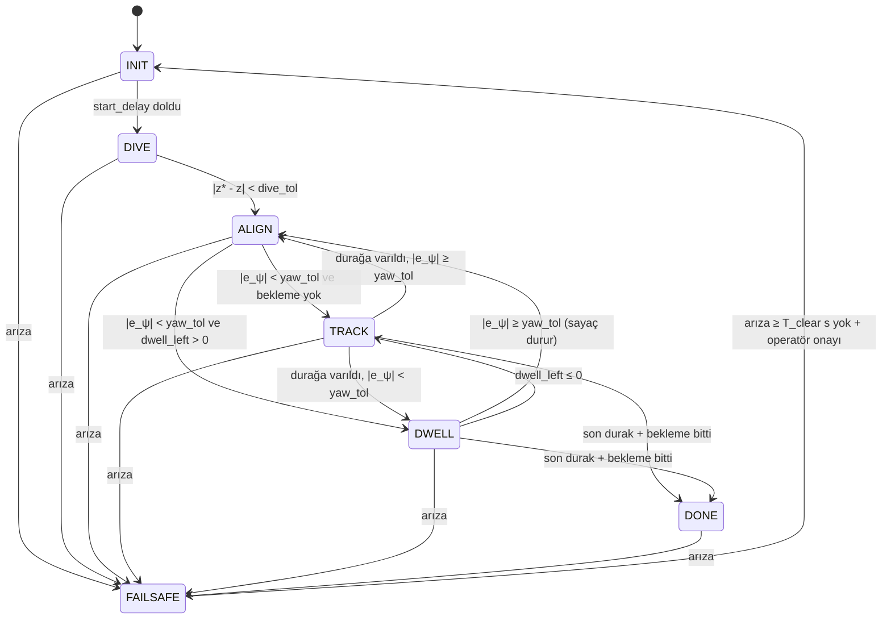

<!-- =============================================================================
     DOSYA : docs/ODEV2_STATE_MACHINE_FAILSAFE.md
     AMAÇ  : Ödev 2'nin doldurulmuş hali: Q1–Q14 cevapları, durum diyagramı, geçiş tablosu,
             T1–T6 (+T7) test sonuçları ve "hâlâ yakalayamadıklarımız" notu.
     ============================================================================= -->
# Ödev 2: Sualtı aracına State Machine + FAILSAFE — Cevaplar

Kod: [`sualti_sim_son/state_machine.py`](../sualti_sim_son/state_machine.py) (yeni), [`motion_node.py`](../sualti_sim_son/motion_node.py), [`controller.py`](../sualti_sim_son/controller.py), [`config/gains.yaml`](../config/gains.yaml).
Testler: [`docs/test_results/`](test_results/). Seviye 1 ve Seviye 2 birlikte yapıldı.

Ortam: Ubuntu 22.04, ROS 2 Humble, Gazebo Fortress (ign 6.18), headless. Tüm sayılar bu ortamda ölçüldü.

---

## Durum diyagramı



## Geçiş tablosu (kodda olan geçişlerin tamamı budur)

| Kaynak | Koşul (ilk doğru kazanır) | Hedef | Kod |
|---|---|---|---|
| her durum ≠ FAILSAFE | onaylanmış arıza (Q5–Q11) | FAILSAFE | `Supervisor.step`, `trip` |
| INIT | t − t_init ≥ start_delay | DIVE | `state_machine.py` |
| DIVE | \|z* − z\| < dive_tol (0.05 m) | ALIGN | 〃 |
| ALIGN | \|wrap(ψ_hedef − ψ)\| < yaw_tol ve dwell_left > 0 | DWELL | 〃 |
| ALIGN | \|wrap(ψ_hedef − ψ)\| < yaw_tol ve dwell_left ≤ 0 | TRACK | 〃 |
| TRACK | gen.done | DONE | 〃 |
| TRACK | v = 0 ve dwell_left > 0 (durağa varıldı) | DWELL (hizalıysa) / ALIGN | 〃 |
| TRACK | v = 0, dwell = 0, yön hatalı | ALIGN | 〃 |
| DWELL | gen.done | DONE | 〃 |
| DWELL | \|e_ψ\| ≥ yaw_tol | ALIGN | 〃 |
| DWELL | dwell_left ≤ 0 | TRACK | 〃 |
| FAILSAFE | arıza yok ≥ fs_clear_time (2 s) **ve** `/auv/failsafe_reset` onayı | INIT | 〃 |

Aynı adımda zincirleme geçiş olabilir (DIVE→ALIGN→TRACK). Eski kodda dalışın bittiği adımda referans da ilerliyordu; bunu korumak için durum oturana kadar en çok 4 kez değerlendirilir.

---

## 2. Seviye 1: Örtük durumlar

### Q1. "Araç şu an hangi aşamada" bilgisini taşıyan değişkenler

| Değişken (orijinal kod) | Değer → aşama |
|---|---|
| `controller.diving` (controller.py:47) | `True` → dalış, yol referansı ilerlemez. `False` → yol aşaması |
| `aligned` (yerel, controller.py:95) | `False` → araç yerinde dönüyor (hizalanma). `True` → duraktan kalkabilir |
| `gen.v` (trajectories.py) | `> 0` → yolda ilerliyor (takip). `0` → bir durakta / başlangıçta duruyor |
| `gen.dwell_left` (trajectories.py:96) | `> 0` → köşede bekliyor. `≤ 0` → bekleme yok |
| `gen.stop_idx` (trajectories.py:95) | kaçıncı kenarda olduğu (0…4). `≥ len(stops)` → son durak geçildi |
| `gen.done` (trajectories.py:97) | `True` → görev bitti, son noktada tutuluyor |
| `node.pose is None` (motion_node.py:107) | `True` → henüz odometri yok |
| `node.t_start is None` (motion_node.py:114) | `True` → görev saati başlamadı |
| `t < start_delay` (motion_node.py:133) | `True` → başlangıç beklemesi, itki 0 |
| `node.ctrl is None` (motion_node.py:137) | `True` → kontrolcü kurulmadı (görev başlamadı) |
| `node.reported` (motion_node.py:79) | `True` → bitiş raporlandı, grafik kaydedildi |
| `node.mission == 'manual'`, `manual_t` | elle sürüş modu, komut taze mi |

### Q2. Geçişler ve koşulları (orijinal kodda)

| Kaynak | Koşul | Hedef | Satır |
|---|---|---|---|
| (bekleme) | `pose ≠ None`, t − t_start ≥ start_delay (3 s) | dalış | motion_node.py:133–137 |
| dalış | \|z* − z\| < 0.05 m | yol (hizalanma) | controller.py:88–89 |
| hizalanma | \|wrap(ψ_hedef − ψ)\| < yaw_tol = 0.087 rad (5°) **veya** v > 0 | takip (`gen.step`) | controller.py:95–96 |
| takip | s_durak − s < 1e-4 m → v = 0, dwell_left = dwell | bekleme / hizalanma | trajectories.py:118–121 |
| bekleme | dwell_left ≤ 0 (sayaç yalnız hizalıyken akar) | takip | trajectories.py:103–106 |
| bekleme/takip | dwell_left ≤ 0 ve stop_idx ≥ len(stops) | bitti | trajectories.py:124–125 |

Yeni kodun bu tabloyu birebir uyguladığını gösteren regresyon testi (Q4'ün altında ve T1'de) iki şekilde yapıldı. Basit modelde 3 görev × 2 dwell değeri için itki farkı tam **0.0** çıktı. Gazebo'da eski ve yeni kodun yolu en çok **0.7 mm** ayrıştı.

### Q3. Karenin 3. köşesi: (0, 4) → zaman ekseni

Kuramsal hesap:
- Dönüş süresi Δψ/ω_max = (π/2)/0.5 = **3.14 s**. Hizalanma yaw_tol = 5° önce bittiği için gerçekte (90° − 5°)/0.5 rad/s ≈ **2.97 s** sürer.
- Bekleme dwell = **2.0 s**.
- Kenar süresi L/v + v/a = 4/0.4 + 0.4/0.2 = **12 s**.

T1'de ölçülen (simülasyon saati, `docs/test_results/T1.log`):

```
t = 51.35 s  TRACK → ALIGN   (3. köşeye varıldı, referans durdu, yaw referansı 0.5 rad/s ile dönüyor)
t = 54.30 s  ALIGN → DWELL   (2.95 s sonra |e_ψ| < 5°)
t = 56.30 s  DWELL → TRACK   (2.00 s bekleme)
t = 68.15 s  TRACK → DWELL   (son kenar 11.85 s; son durakta hiza zaten doğru → doğrudan DWELL)
t = 70.15 s  DWELL → DONE
```

Ölçüm hesapla uyuşuyor: dönüş 2.95 s (beklenen 2.97), bekleme 2.00 s, kenar 11.85 s (beklenen 12 s; trapez profilde durağa son 0.1 mm'de oturulduğu için biraz kısa). Bir sıra notu: köşede önce **dönülür, sonra beklenir**. Sebebi, bekleme sayacının yalnız araç hizalıyken akması (eski kodda `aligned or v > 0`).

### Q4. Tek durum değişkeni: 7 durum

| Durum | Eylem a(S) | Aktif PID | Referans ilerliyor mu |
|---|---|---|---|
| INIT | itki 0, start_delay bekle | yok | hayır |
| DIVE | z_ref hedefe 0.15 m/s ile kayar | z, yaw, x/y (yerinde tut) | hayır |
| ALIGN | yaw referansı 0.5 rad/s ile döner | z, yaw, x/y | hayır |
| TRACK | trapez profil, ileri besleme | hepsi | **evet** |
| DWELL | bekleme sayacı akar | hepsi | evet (s sabit, sayaç azalır) |
| DONE | son noktada tut | hepsi | hayır |
| FAILSAFE | arızaya göre `zero` / `hold` / `ascend` (Q12) | `hold` ise yalnız z | hayır |

---

## 3. Seviye 1: FAILSAFE tasarımı

### Q5. Odometri bayatlaması

Eski `_odom_cb` **zaman damgası saklamıyordu**: son poz sonsuza dek "geçerli" sayılıyordu. Artık mesajın alındığı an duvar saatiyle (`STEADY_TIME`) saklanıyor ve yaş = şimdi − t_son_odom olarak hesaplanıyor.

- Odometri 50 Hz (20 ms), kontrol 20 Hz (50 ms). Normalde bir kontrol adımında yaş ≤ 20 ms + titreşim olur. T1'de ölçülen en büyük yaş **0.025 s**.
- Alt sınır: bir kontrol periyodu + bir odom periyodu = 70 ms. Bu, tek bir gecikmede bile yanlış alarm verir. Ayrıca gerçek zaman çarpanı dalgalanır ve DDS'te 100–200 ms takılmalar olur. Bu yüzden en az 4–5 kontrol periyodu (≈ 0.2–0.25 s) gerekir.
- Üst sınır (kör gidiş): v·T_stale = 0.4·T_stale. T_stale = 0.5 s → **0.2 m**, bu kabul edilebilir.
- **Seçim: T_stale = 0.5 s** = 25 odom periyodu = 10 kontrol periyodu. Normal en büyük yaşın 20 katı olduğu için yanlış alarm pratikte yok.

### Q6. Saat tuzağı

- Düğüm `use_sim_time` kullanıyor, 20 Hz `create_timer` da simülasyon saatine bağlı. Köprü ölünce `/clock` durur, ROS zamanı ilerlemez ve **20 Hz zamanlayıcı bir daha hiç tetiklenmez**. `_loop` çalışmadığı için bayatlığı denetleyecek kod da çalışmaz. Gazebo son itkiyi tutar. Bu sessiz bir arızadır.
- Bu yüzden watchdog **duvar saatiyle** çalışmalı: `Clock(clock_type=ClockType.STEADY_TIME)` ile kurulan ayrı bir zamanlayıcı, yani `create_timer(0.05, self._watchdog, clock=self.steady)`. `SYSTEM_TIME` de çalışır, ama `STEADY_TIME` monotondur (NTP/elle saat değişiminde zıplamaz). Watchdog, kontrol döngüsünün son çalıştığı anı ve son odometri anını duvar saatiyle denetler. İkisi T_stale'den eskiyse FAILSAFE'e geçirir ve itki 0 yayınlar.
- **Gazebo kullanıcı tarafından duraklatılırsa** odometri ve sim zamanı durur. Duvar saatli watchdog 0.5 s sonra FAILSAFE'e geçer. **Bu istenen davranış**, çünkü düğüm "simülasyon durdu" ile "köprü/sensör öldü" durumlarını ayırt edemez; ikisinde de elinde güncel ölçüm yoktur. FAILSAFE kilitli olduğu için Gazebo devam ettirildiğinde araç kendiliğinden kalkmaz, operatör onayı gerekir. Gerçek araçta "duraklatma" diye bir şey yoktur. Duraklatmayı sık kullanan geliştirici `fs_odom_timeout`'u büyütebilir.
- Hiçbir denetimin atlanmaması için `_loop`'ta arıza tespiti, `dt` ve "ilk adım" `return`'lerinden **önce** yapılır. Eski kod `dt ≤ 0 veya dt > 0.5` olduğunda erken dönüyordu; arıza tam o adımlarda olursa (sim duraklatılmış / kopukluk) hiç fark edilmezdi.

### Q7. Geçersiz sayı (NaN / inf)

- **Nerede doğar:**
  - dt = 0 → `w_ref = dψ/dt`, türev `(e_k − e_{k−1})/dt` (pid.py'de dt ≤ 0 ise 0 döner; controller'da `max(dt, 1e-6)` var).
  - `atan2(0, 0)`: yol yönü (trajectories.py'de sıfır uzunluklu segment atılarak önlenmiş).
  - `asin(>1)` → `ValueError` (Q8).
  - Bölme: `u = (s − s_i)/(s_{i+1} − s_i)`, `phi = s/r`.
  - Ve en önemlisi **gelen odometrinin kendisi** (köprü/eklenti NaN gönderebilir).
- **`_publish` ne yapıyor:** komutta NaN/inf varsa tüm itkileri 0 yapıyor. Bu Gazebo'yu korur ama **yetmez**:
  1. Tek bir NaN ölçüm PID integraline girerse `integral = NaN` olur ve **kalıcıdır**. Ölçüm düzelse bile kontrolcü sonsuza dek NaN üretir.
  2. `_publish` sorunu belirtisinden yakalar, kaynağını değil. Araç her adımda "itki 0" ile "normal" arasında gidip gelebilir ve bu bir durum olarak kaydedilmez.
- Bu yüzden **odometri girişte denetlenir** (`finite`) ve tek NaN örneğinde (N = 1) FAILSAFE'e geçilir. FAILSAFE'ten çıkışta kontrolcü yeniden kurulur, PID'ler sıfırdan başlar.

### Q8. Devrilme

- **(a)** asin argümanı sayısal hatayla 1.0000001 olursa Python `math.asin` **ValueError fırlatır** ve düğüm çöker (NaN bile değil). Çözüm kırpmak: `θ = asin(clamp(2(wy − zx), −1, 1))` (`quat_to_roll_pitch`). Birim testi: `test_roll_pitch_clamp`.
- **(b)** Ağırlık merkezi 5 cm aşağıda: M ≈ m·g·h·sinφ = 13.04·9.81·0.05·sinφ ≈ **6.4·sinφ N·m**. Moment φ = 90°'de en büyüktür, φ > 90°'de azalır, φ = 180°'de sıfırdır (ters denge, kararsız).
  - T1'de normal çalışmada |φ| ≤ 0.25°, |θ| ≤ 1.8°.
  - Pitch'i en çok bozan şey surge itkisi. İticiler ağırlık merkezinin 5 cm üstünde; surge ~30 N → 1.5 N·m → en kötü θ ≈ asin(1.5/6.4) ≈ 13.5°.
  - 45°'de dikey iticilerin düşey etkisi cos45 = %70'e iner. Yatay iticiler 0.7·F düşey kuvvet üretmeye başlar, derinlik ve konum kontrolü birbirine karışır.
  - Kendi kendine düzelen bir araçta >45° eğim normal dinamikle açıklanamaz: çarpma, takılma, itici arızası ya da kötü ölçüm gerekir.
  - **Eşik: 45° (0.785 rad)**. Normal en büyüğün ~25 katı, kuramsal en kötü durumun 3 katı.
  - Eylem `zero`: eğikken itki yönleri yanlıştır, pasif geri getirme momenti aracı düzeltir.

### Q9. Derinlik sınırı

- Zemin z = −3.0 (pool.sdf: kutu merkezi −3.05, kalınlık 0.1). Araç yarı yüksekliği 0.1 m olduğu için araç merkezi en çok z = −2.9'a inebilir.
- Hızlı inişte durma mesafesi (heave, m_eff = 13.04 + 10 = 23 kg, d₁ = 10, d₂ = 70):
  - **İtki 0 ile süzülme** (w₀ = 0.15 m/s): x = (m/d₂)·ln(1 + d₂w₀/d₁) = **0.24 m** (yalnız doğrusal sürtünmeyle 0.35 m). Bu pay **eklenmeli**, çünkü yarı yükseklikten büyük.
  - **Aktif fren** (FAILSAFE `ascend`, 20 N yukarı): a ≈ (20 + 1.5 + 1.6)/23 ≈ 1.0 m/s² → w²/(2a) = **0.011 m**.
  - **Algılama gecikmesi** (debounce 3 örnek = 0.15 s): 0.15·0.15 = **0.02 m**.
- **z_min = −3.0 + 0.1 + 0.24 + 0.02 ≈ −2.64 → −2.6** (itkiler tamamen ölse bile zemine değmez; aktif frenle 0.27 m pay kalır).
- **z_max = −0.2**: araç üstü yüzeyin 10 cm altında. Görev hiçbir zaman başlangıç derinliğinin (−1.5) üstüne çıkmaz. z > −0.2 olması derinlik kontrolünün kaybolduğu anlamına gelir (iticiler hava emer).
- **Güvenli aralık: [−2.6, −0.2] m** (dünya z'si). Mevcut görev −1.5'te başlayıp 0.5 m dalar → −2.0; arada 0.6 m pay var. Görev başlarken z* = z₀ − dive_depth bu aralığın dışındaysa düğüm uyarı yazar (T3).

### Q10. Takip hatası ve doyma

- T1'de (normal kare görev) e = ‖p_ref − p‖ için en büyük değer **0.119 m** (köşede ALIGN/DWELL sırasında). TRACK sırasında 0.111 m.
- **e_max = 0.6 m ≈ 5 kat.**
  - 2–3 kat, dalga/akıntı gibi gerçek bozucularda yanlış alarm verir.
  - 10 kat (1.2 m) 4 m'lik kare için fazla kaba kalır.
  - 0.6 m, bir kenarın %15'i ve normal hata ile çarpışma/takılma arasında net bir ayrım.
- **Doyma:** itkiler T s boyunca sürekli |F| = F_max ise kontrolcü istediğini elde edemiyor demektir:
  - araç bir şeye sıkışmış (duvara itiyor),
  - akıntı/sürükleme itki kapasitesini aşıyor,
  - ya da bir itici bozuk (diğerleri telafiye çalışıyor).
  - Kısa doymalar normaldir (hızlı köşe, basamak komut). T1'de hiç doyma olmadı (max_thrust 20 N, en büyük talep ~18 N).
- **T seçimi:** en uzun meşru geçici olaydan uzun olmalı. Bir köşe dönüşü ≈3 s, kenar başında hızlanma 2 s. **T_sat = 3 s.** 3 s'lik doyma 0.4 m/s'de 1.2 m'lik sapma demek, hâlâ havuz içinde müdahale edilebilir.
- Takip ve doyma denetimi yalnız görev durumlarında yapılır (INIT'te referans yok).

### Q11. Yanlış alarm / debounce

Gürültüde tek örnekte yanlış alarm olasılığı p ise N ardışık örnek için pᴺ olur. Örneğin p = 0.01, N = 3 → 10⁻⁶. Bedel: N·0.05 s gecikme.

| Arıza | N (20 Hz) | Gecikme | Neden |
|---|---|---|---|
| odom_stale | – | T_stale = 0.5 s | yaşın kendisi bir süre ölçüsü (zaten filtrelenmiş) |
| nan | **1** | 0.05 s | NaN gürültü değil, ve tek NaN PID integralini kalıcı bozar |
| tilt | 5 | 0.25 s | çarpma/dalga anlık sıçratabilir; gerçek devrilme saniyeler sürer |
| depth_low / depth_high | 3 | 0.15 s | basınç sensörü gürültüsü; 0.15 m/s inişte yalnız 2 cm |
| track_error | 20 | 1.0 s | köşede kısa süreli büyümeler olabilir; yavaş gelişen bir arıza |
| saturation | 1 | T_sat = 3 s | doyma süresi zaten bir zaman filtresi |

Uygulama: `Supervisor.count[arıza]`. Koşul doğruysa +1, yanlışsa 0. Sayaç N'ye ulaşınca arıza onaylanır (`test_debounce_tilt`).

### Q12. Arıza eylemi (fizik)

**(A) Tüm itki 0**, surge (m_eff = 12.74 + 0.3 + 4 = 17.0 kg, d₁ = 5, d₂ = 20), v₀ = 0.4 m/s:

| Model | Durma süresi | Mesafe |
|---|---|---|
| Yalnız doğrusal: τ = m/d₁ | τ = 3.4 s (%95 → 3τ = 10.2 s) | x = v₀τ = **1.36 m** |
| Doğrusal + ikinci derece | %95 → 7.2 s | x = (m/d₂)·ln(1 + d₂v₀/d₁) = **0.81 m** |
| Yalnız ikinci derece | v = v₀/(1 + d₂v₀t/m), hiç durmaz | 40 s'de 2.5 m (log büyür) |
| **Gazebo (T2: köprü dönünce v₀ ≈ 0.38)** | %95 ≈ 8 s | **≈ 0.96 m** |
| **Gazebo (T4: NaN anında v₀ = 0.405)** | %95 → **7.22 s** | **0.78 m** (%95'e kadar), 0.85 m (toplam) |

Simülasyon "doğrusal + ikinci derece" modeliyle örtüşüyor: T4'te 0.78 m / 7.22 s ölçüldü, hesap 0.81 m / 7.2 s. Yalnız doğrusal model mesafeyi %70 fazla buluyor; ikinci derece terim mesafeyi neredeyse yarıya indiriyor. T2'deki 0.96 m biraz daha uzun, çünkü köprü geri gelirken birkaç komut kaçıyor.

T3'te ölçülen yükselme: −2.5 → −1.0 arası **3.25 s** (1.5 m; hesap durağandan başlayınca 3.6 s, araç −2.5'i geçerken zaten yukarı hızlanmıştı). İtki −1.0'da kesildikten sonra araç **−0.499 m**'de durdu (hesap ≈ −0.5).

**(C) Açık çevrim yukarı:** F = d₁w + d₂w² → w = (−d₁ + √(d₁² + 4d₂F)) / (2d₂). Heave: d₁ = 10, d₂ = 70, m_eff = 23 kg.

| F_yukarı | Terminal w | Zaman sabiti | 1.5 m çıkış |
|---|---|---|---|
| 20 N (seçilen) | **0.47 m/s** | 0.31 s | **3.6 s** |
| 40 N (2 × 20 N, tam) | 0.69 m/s | 0.22 s | 2.5 s |

20 N seçildi: yüzeye 0.47 m/s ile çarpmamak ve itici payı bırakmak için. Kesildikten sonra 0.47 m/s'den süzülme 0.48 m sürer. Bu yüzden itki z = −1.0'da kesilir ve araç ≈ −0.5'te durur (z_max içinde kalır, yüzeyi delmez).

**Hangi arıza için hangi eylem?**

| Arıza | Eylem | Gerekçe |
|---|---|---|
| odom_stale | **A: itki 0** | Konum/derinlik bilinmiyor, kapalı çevrim derinlik tutulamaz. Açık çevrim yükselişin ne zaman duracağı da bilinmez. Araç nötr yüzer, batmaz; itki 0 ile 0.8–1 m'de durur. |
| nan | **A** | Ölçüm anlamsız; aynı gerekçe |
| tilt | **A** | Eğikken itki yönleri yanlış; pasif 6.4·sinφ N·m geri getirme momenti düzeltir |
| depth_low | **C: yüksel** (kapalı çevrimle durdurulur) | Zemine yaklaşıyor. A ile 0.24 m daha süzülür, C ile 1 cm'de frenler. Odometri sağlam olduğu için z ≥ −1.0'da kesilir; süre sınırı 10 s. |
| depth_high | **A** | Zaten yüzeyde; itmek anlamsız |
| track_error, saturation | **B: derinliği tut** | Odometri sağlam. Takılmış/sürükleniyorsa yatay itkiyle zorlamak (duvara itmek) zarar verir; derinliği tutmak aracı kontrollü bekletir. |

### Q13. Kilitleme (latch) ve çıkış

- FAILSAFE'ten **otomatik çıkılmaz**.
- Arıza geçince hemen DIVE/TRACK'e dönmek tehlikeli olabilir:
  1. Aralıklı arızalar (gevşek kablo, kopup gelen köprü) FAILSAFE ile normal arasında **titreşim** yaratır. Her girişte itki sıçrar.
  2. Arıza süresince **referans ve PID integralleri bayatlamıştır**: referans noktası metrelerce ilerde olabilir (T2'de araç 4.6 m sürüklendi), integral birikmiş olabilir. Dönüşte büyük basamak komut → doyma → yeni arıza olur.
  3. Arızanın nedeni (çarpma, devrilme) giderilmemiş olabilir; bunu insan bilir.
- **Kural:** arıza koşullarının **hiçbiri** (debounce'suz ham koşul dahil) **T_clear = 2 s** boyunca doğru olmamalı **VE** bu süre dolduktan **sonra** gelen bir operatör onayı olmalı. Erken gelen onay reddedilir ve loglanır (T6). Onaydan sonra **INIT**'e gidilir: kontrolcü atılır, start_delay yeniden beklenir, görev o anki pozdan taze PID'lerle yeniden başlar.
- **Onay `std_msgs/Empty` konusu (`/auv/failsafe_reset`) ile gelir, parametreyle değil.** Onay bir **olay**dır (kenar), parametre ise bir **durum**dur. `failsafe_ack: true` parametresi true kaldığı sürece **sonraki her FAILSAFE'i de** otomatik onaylar ve latch'i işe yaramaz hale getirir. Ayrıca yaml'da kalıcı olarak unutulabilir. Konu mesajı bir kez işlenir ve tüketilir.
  ```bash
  ros2 topic pub --once /auv/failsafe_reset std_msgs/msg/Empty "{}"
  ```

### Q14. Düğüm ölürse

- `main()` içindeki `finally: node.stop()` yalnızca **düzgün kapanışı** kapsar: Ctrl+C (SIGINT, sinyal işleyicisi kapatıldığı için), `spin`'den çıkan Python istisnaları ve normal çıkış.
- Kapsamadıkları:
  - `SIGKILL` / OOM killer, segfault (C uzantısında), güç kesilmesi,
  - süreç canlı ama **donmuş** (sonsuz döngü, kilitlenme: tek iş parçacıklı executor'da watchdog da donar),
  - DDS/köprü ölümü (stop yayınlanır ama **Gazebo'ya ulaşmaz**, T2'de gösterildi),
  - `stop()` mesajının 0.1 s'de ağdan çıkamaması.
- **Gerçek araçta bağımsız mekanizma:**
  1. **İtici sürücüsünde (ESC/mikrodenetleyici) komut zaman aşımı**: her ESC son komutu en çok 200–500 ms uygular, yeni komut gelmezse kendiliğinden 0'a iner. Bu, bilgisayardan bağımsız bir "dead-man" anahtarıdır.
  2. **Donanım watchdog'u**: ana bilgisayar periyodik kalp atışı (heartbeat) göndermezse MCU itici gücünü keser.
  3. **Fiziksel kill-switch** (manyetik reed anahtar) ve **hafif pozitif yüzerlik / bırakılabilir ağırlık**: her şey ölse de araç yavaşça yüzeye çıkar.

  Simülasyondaki karşılığı Gazebo itici eklentisinde komut zaman aşımı olurdu. Fortress `Thruster` eklentisinde böyle bir seçenek yok (eklenti dizgileri kontrol edildi).

---

## 4–5. Kodlama (Seviye 1 + Seviye 2)

- `state_machine.py`: `State` (7 durum), `Supervisor` (`_check_faults`, `_set`, `trip`, `acknowledge`, `step`, `action`, `advance`). Eşiklerin hepsi `gains.yaml`'da (`fs_*`); kodda sihirli sayı yok.
- **Seviye 2:** `controller.py` içindeki `diving` bayrağı ve `aligned`/`v > 0` kararı kaldırıldı. Kontrolcü artık yalnız `update(..., advance)` ile "referansı ilerlet" komutunu alır. Geçiş koşullarının girdileri `phase_inputs()` ile Supervisor'a verilir. Bekleme sayacı (`gen.dwell_left`) üreteçte kaldı, ama DWELL/ALIGN kararı Supervisor'da.
- Bağlama noktaları (`motion_node.py`):
  1. `_odom_cb`: odometrinin alındığı an duvar saatiyle saklanır, roll/pitch hesaplanır, test için `inject_fault` uygulanır.
  2. `_loop`: arıza girdileri `dt`/ilk adım dönüşlerinden önce toplanır, `Supervisor.step` çağrılır. Mod `normal` değilse `ctrl.update` sonucu kullanılmaz, Q12 eylemi uygulanır.
  3. `_watchdog`: duvar saatli zamanlayıcı, `/clock` öldüğünde FAILSAFE + itki 0.
  4. `/auv/state` (durum yayını), `/auv/failsafe_reset` (onay), CSV kaydı (`~/auv_logs/`).
- Birim testleri: `python3 -m pytest test/ -q` → 7 test geçti.

---

## 6. Test sonuçları

Grafikler `ros2 run sualti_sim_son plot_run <csv>` ile çizildi: yol, derinlik + güvenli aralık, **durum-zaman**, arıza girdileri. Her testin `.log` dosyasında "FAILSAFE: sebep=..., t=..." satırı var.

| # | Arıza nasıl oluşturuldu | Beklenen | Gözlenen durum dizisi | Ölçüm | Sonuç |
|---|---|---|---|---|---|
| **T1** | arıza yok, `mission:=square` | INIT→DIVE→TRACK→DONE, FAILSAFE yok | INIT→DIVE→ALIGN→TRACK→(ALIGN→DWELL→TRACK)×3→DWELL→DONE | Eski koddan en büyük sapma **0.70 mm** (4966 ortak örnek, [T1_regresyon.png](test_results/T1_regresyon.png)). e_max 0.119 m, pitch ≤ 1.8°, doyma 0 s, odom yaşı ≤ 25 ms | ✅ |
| **T2** | görev sırasında `pkill -f parameter_bridge` (TRACK, 0.38 m/s) | TRACK→FAILSAFE, tespit ≈ T_stale, itki 0 | TRACK→FAILSAFE (`odom_stale`) | Tespit: kontrol döngüsü durduktan **0.52 s** sonra (T_stale 0.5 + watchdog periyodu). Düğüm 0.5 s içinde 6 iticiye **0** yayınladı (ROS tarafında doğrulandı). Ama komut Gazebo'ya **ulaşmadı**: araç **12 s'de 4.6 m** daha gitti ([T2_gazebo_kayma.png](test_results/T2_gazebo_kayma.png)) | ✅ yazılım / ⚠️ fiziksel (Q14) |
| **T3** | `params:=test/params/T3_dive_depth.yaml` (`dive_depth: 2.8` → z* = −4.3) | DIVE→FAILSAFE (derinlik), zemine çarpmadan durur/çıkar | INIT→DIVE→FAILSAFE (`depth_low`, `ascend`) | Açılışta uyarı: "z* = −4.30 güvenli aralık dışında". FAILSAFE z = −2.622'de, inişin 0.15 m/s olduğu anda. En derin **−2.636** (zemin teması −2.905; **0.27 m pay**). −1.0'da itki kesildi, **−0.499**'da durdu | ✅ |
| **T4** | `ros2 param set /motion_node inject_fault nan_odom` (TRACK'te) | →FAILSAFE (geçersiz sayı), Gazebo çökmüyor | TRACK→FAILSAFE (`nan`, `zero`), **ilk NaN adımında** | Gazebo çalışmaya devam etti (Gazebo odom kaydı 32.5 s'ye kadar kesintisiz), Traceback yok. Araç 0.405 m/s'den 0.78 m süzülüp durdu (Q12-A) | ✅ |
| **T5** | `max_thrust: 3.0` | →FAILSAFE (takip/doyma) | FAILSAFE **yok**, görev normal | 3 N ile yatay kapasite 4·3·cos45 = 8.5 N, 0.4 m/s sürtünmesi 5.2 N: **kontrol yetiyor**. e_max 0.131 m < 0.6, en uzun doyma 0.8 s < 3 s. Q10 eşiğine göre arıza yok; doğru karar (yanlış alarm yok) | ✅ (Q10 eşiğine göre) |
| **T5c** | `max_thrust: 3.0` + `cruise_speed: 0.8` (kontrol gerçekten yetmesin: 16.8 N > 8.5 N) | →FAILSAFE (takip/doyma) | TRACK→FAILSAFE (`saturation`, `hold`) | TRACK'e girdikten 5.1 s sonra, doyma 3.05 s (o anda e = 0.64 m; takip hatası da eşikteydi). `hold` derinliği 3 mm içinde tuttu | ✅ |
| **T5b** | `max_thrust: 1.0` (ek deneme) | →FAILSAFE (takip/doyma) | DIVE→ALIGN→TRACK→FAILSAFE (`depth_low`) | **Beklenmedik**: dikey iticiler sürekli +1 N yukarı iterken araç 1.27 m/s'ye hızlanarak battı (nötr araçta fiziksel olarak açıklanamıyor; Gazebo itici/hidrodinamik modeli zayıf/doymuş komutta ayrıca incelenmeli). Derinlik FAILSAFE'i z = −2.68'de yakaladı, ama bu hızda 20 N'luk yükselme freni yetmedi, **araç zemine değdi** (z = −2.905). Bölüm 7'ye bakın | ⚠️ |
| **T6** | T2'nin devamı: köprü yeniden başlatıldı (arıza giderildi), 1.5 s sonra onay, 5 s sonra yine onay | FAILSAFE'te kal, onayla çık | FAILSAFE (kendiliğinden çıkmadı) → 1. onay **RED** ("arızasız süre 1.9 s < 2.0 s") → 2. onay **KABUL** ("7.1 s arızasız") → INIT→DIVE→ALIGN→TRACK... | Görev o anki pozdan taze kontrolcüyle yeniden başladı | ✅ |
| **T7** (ek) | `inject_fault tilt` (+69° roll) | →FAILSAFE (devrilme) | TRACK→FAILSAFE (`tilt`, `zero`) | İlk eğik örnekten 0.20 s sonra (5. ardışık örnek, Q11) | ✅ |

Grafikler: [T1](test_results/T1.png) · [T2+T6](test_results/T2.png) · [T3](test_results/T3.png) · [T4](test_results/T4.png) · [T5](test_results/T5.png) · [T5b](test_results/T5b.png) · [T5c](test_results/T5c.png) · [T7](test_results/T7.png). Her testin `.log`, `.csv` (düğüm kaydı), `_gazebo_odom.csv` (köprüden bağımsız Gazebo kaydı) ve `_olaylar.txt` (betik olay zamanları) dosyaları da aynı klasörde.

T2 logunun son satırındaki ikinci FAILSAFE (t = 68.55 s), test sonunda Gazebo kapatılınca watchdog'un yine devreye girmesidir; beklenen davranış.

Testleri tekrar çalıştırmak için:
```bash
ros2 launch sualti_sim_son sim.launch.py mission:=square                                   # T1
pkill -f parameter_bridge                                                                  # T2 (başka terminalde, görev sırasında)
ros2 launch sualti_sim_son sim.launch.py mission:=square params:=<paket>/test/params/T3_dive_depth.yaml   # T3
ros2 param set /motion_node inject_fault nan_odom                                          # T4 (görev sırasında)
ros2 launch sualti_sim_son sim.launch.py mission:=square params:=<paket>/test/params/T5c_max_thrust_hiz.yaml  # T5c
ros2 topic pub --once /auv/failsafe_reset std_msgs/msg/Empty "{}"                          # T6 onayı
ros2 run sualti_sim_son plot_run ~/auv_logs/auv_square_<tarih>.csv -o T.png                # grafik
```

---

## 7. Hâlâ yakalayamadığımız arızalar ve gerçek araçta ne eklerdik?

**Yakalayamadıklarımız (testlerle gösterildi veya tasarım gereği):**

1. **"Sıfır" komutunun gerçekten ulaştığını bilmiyoruz (T2).** Düğüm arızayı 0.52 s'de yakaladı ve itki 0 yayınladı, ama köprü ölü olduğu için Gazebo son itkiyi tuttu: araç 12 s'de **4.6 m kör sürüklendi**. Yazılım tarafındaki FAILSAFE, aradaki taşıma katmanı ölünce işe yaramıyor. Aynı şey düğüm `SIGKILL`/segfault ile ölünce ya da donunca da olur (tek iş parçacıklı executor'da watchdog da donar).
2. **Hızlı batma / beklenmeyen dış kuvvet (T5b).** z_min, en büyük iniş hızının dive_rate (0.15 m/s) olduğu varsayımıyla seçildi. T5b'de araç 1.27 m/s ile battı: eşik aşıldığında frenleme mesafesi payı aştı ve araç zemine değdi. Statik derinlik sınırı hızı hesaba katmıyor.
3. **Derinlik sensörü ve konum aynı kaynaktan (Gazebo odometrisi) geliyor.** Odometri yanlış ama sonlu ve taze ise (kayma, sabit kalma, ölçek hatası) hiçbir denetim yakalamaz. "Odometri donmuş ama yayınlanıyor" (aynı değer tekrar ediyor) da yakalanmıyor.
4. **İtici arızası** (tek iticinin durması / ters dönmesi) ancak dolaylı olarak, takip hatası veya doyma eşiğe gelince yakalanır. Komut ile ölçülen hareket arasındaki tutarsızlık doğrudan izlenmiyor.
5. **Engel / duvar / çarpma**: konum sensörü dışında sensör yok. Havuz duvarı modelde de yok.
6. **Göreli dalış**: FAILSAFE'ten onayla çıkınca görev o anki derinlikten tekrar `dive_depth` kadar dalıyor (T2'de −2.0 → −2.5, z_min'e 2 cm kala). Hedef derinlik mutlak olmalı ya da görev başında z* ∈ [z_min, z_max] zorunlu tutulmalı (şu an yalnız uyarı).
7. **Elle (manual) mod** state machine'in dışında. Yalnız NaN ve 1 s komut zaman aşımı var.
8. **Pil / sızıntı / sıcaklık / iletişim kopması** simülasyonda yok.

**Gerçek araçta ne eklerdik:**

- **İtici sürücüsünde (ESC/MCU) komut zaman aşımı + donanım watchdog'u + kalp atışı:** 200–500 ms yeni komut yoksa itici kendiliğinden 0. 1. ve kısmen 4. maddeyi bilgisayardan bağımsız çözer (Q14). Ayrıca manyetik kill-switch ve hafif pozitif yüzerlik, yani "her şey ölürse araç yüzeye çıkar".
- **Bağımsız basınç (derinlik) sensörü + IMU** ve odometri ile çapraz denetim (3. madde). Derinlik FAILSAFE'i basınç sensörüne bağlanır; IMU eğimi doğrudan verir.
- **Hıza duyarlı derinlik sınırı** (2. madde): z_tahmin = z + w·t_algılama − w²/(2a_fren) < z_min ise arıza. Ayrıca dikey hız sınırı (|w| > 0.4 m/s → arıza) eklenir.
- **İtici geri bildirimi** (ESC akım/devir ölçümü): komut ile gerçekleşen itki karşılaştırılır (4. madde).
- **Sızıntı sensörü, pil gerilimi (histerezisli, ödevdeki mini örnek gibi), iç sıcaklık** ile ek arızalar ve eylem: yüzeye çık.
- **Sonar / mesafe sensörü** ile engel ve zemin mesafesi (5. madde).
- Kontrol döngüsü ile watchdog'u ayrı iş parçacığına/süreçe ayırmak (`MultiThreadedExecutor` + ayrı callback grubu, ya da ayrı "safety" düğümü).
